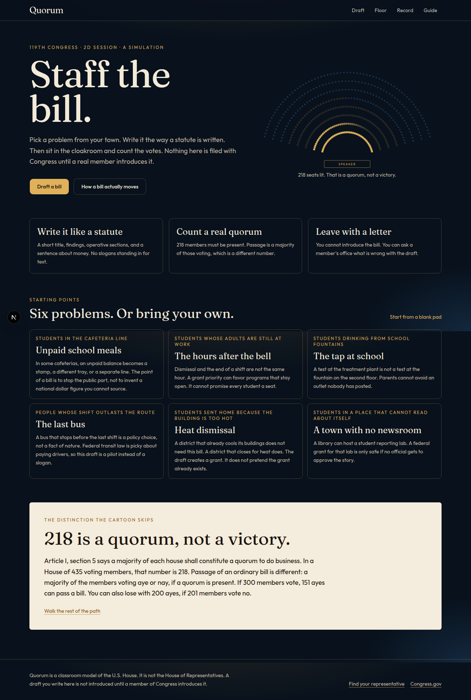
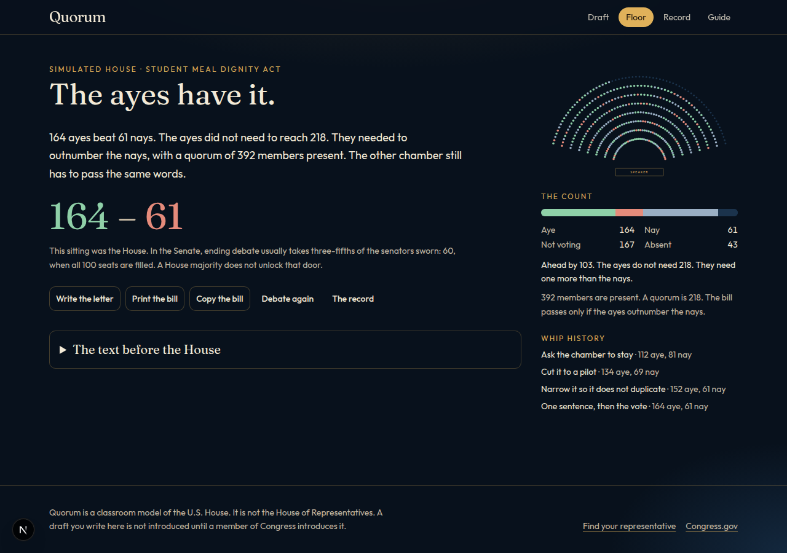

# Quorum

Quorum is a classroom model of the U.S. House. You staff a member for a day: pick a problem from your town, write it in the shape of a real bill, and whip a simulated floor. A quorum and a majority are different numbers. Nothing in the app is introduced in Congress. Only a member can do that, so the last thing you produce is a letter an office can actually answer.





## Run it

You need Node.js 22 or newer.

```bash
npm install
npm run dev
```

Open [http://localhost:3847](http://localhost:3847).

Drafts stay in your browser. There is no account and no server database. A share link carries the bill text in the link itself.

## What you can do

- Start from six community problems, or from a blank pad. The six are drafts, not finished findings. Each one names what you should go check.
- Write a short title, an official title, findings, operative sections, and a sentence about money.
- Send the text to a simulated House. The members are fictional. Your answers move the whip count.
- Read the result against the real rule: 218 members must be present, and passage is a majority of those voting aye or nay.
- Save the draft, print it, copy it, or generate the letter. Look the member up at [house.gov](https://www.house.gov/representatives/find-your-representative) before you put a name on it.
- Walk the rest of the path under Guide, including committee silence, the Senate, and what a signature does not do.

## Track time with Hackatime

The project name is `quorum`, set in `.wakatime-project`. Hackatime only counts time in your editor.

1. Create an account at [hackatime.hackclub.com](https://hackatime.hackclub.com).
2. Open the Cursor setup from [the Hackatime Cursor guide](https://hackatime.hackclub.com/docs/editors/cursor) and run the setup page linked there. That page writes your API key on your machine. Do not commit it.
3. In Cursor, install the **WakaTime** extension and reload the window.
4. Open this project and edit it. Heartbeats show up on your Hackatime page after a few minutes.

If the plugin is silent, check that `~/.wakatime.cfg` contains:

```ini
[settings]
api_url = https://hackatime.hackclub.com/api/hackatime/v1
api_key = your-key
```

## Make it yours before you call it yours

This repository was drafted with Cursor's coding agent. Congressional App Challenge rules allow AI tools when the use is disclosed and the AI work is not the whole project. Change the app, and be ready to explain the part you keep.

Three edits that teach the code:

- Add a problem from your own school in `src/lib/issues.ts`. Replace any general finding with a document you can hand someone.
- Change the whip math in `src/lib/debate.ts`. A path that always passes, or never passes, is a broken lesson.
- The floor is only the House. A Senate sitting needs cloture, and the number is not 218.

## Entering the Congressional App Challenge

Registration for the 2026 challenge closed on October 26, 2026. Watch [congressionalappchallenge.us](https://www.congressionalappchallenge.us/students/student-registration/) for the next cycle. `SUBMISSION.md` has a demo-video shot list and draft answers, with blanks for your name, school, and district. Do not file those answers as if you wrote every line of this repo.

## Submitting to Hack Club

Hack Club's certificate for an open-source Congressional App Challenge project is described at [capitol.hackclub.com/certificate](https://capitol.hackclub.com/certificate). The published deadline for the last round was October 26, 2026. If a form is open, send the public repository, the playable link, and the Hackatime project name `quorum`. Questions go to capitol@hackclub.com.

The repository a reviewer can certify has the source, this README, a screenshot, and the MIT license. It does not contain API keys.

## License

MIT. See [LICENSE](LICENSE).
